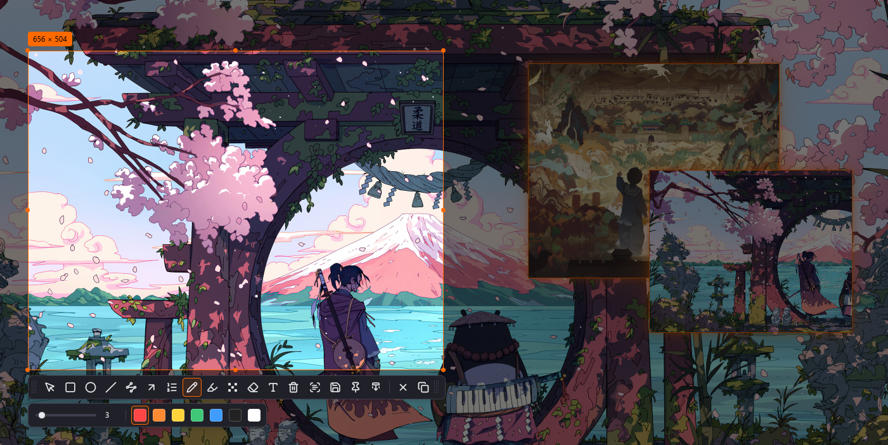

import { Card, CardGrid } from '@astrojs/starlight/components';

## Highlights

<CardGrid stagger>
	<Card title="Wayland-native" icon="mdi:monitor">
		Built on <code>wlr-screencopy</code> and layer-shell; at home on niri, sway,
		Hyprland and other wlroots-adjacent compositors. Mixed-scale, rotated
		multi-monitor setups are handled — selections may span screens.
	</Card>
	<Card title="Private OCR" icon="mdi:text-recognition">
		Text recognition runs on-device. After a one-time ~31 MB model download,
		nothing ever leaves your machine.
	</Card>
	<Card title="Long screenshots" icon="mdi:scroll">
		Frame the scrolling region, scroll it yourself, and watch the stitched page
		grow in a live side preview. If part of the selection doesn't scroll along,
		the session stops safely and keeps what it captured.
	</Card>
	<Card title="Pin" icon="mdi:pin">
		Crop a selection into an always-on-top floating image that outlives the
		screenshot UI; drag it across screens, scroll to zoom.
	</Card>
	<Card title="A full annotation kit" icon="mdi:draw">
		Shapes, arrows, numbered steps, freehand, highlighter, mosaic/blur and text —
		all editable and undoable after the fact.
	</Card>
</CardGrid>

## Status

Shotori is in active, pre-1.0 development. The core flows — capture, annotate,
copy, save, OCR, pin, long screenshots — are in daily use, but the CLI,
keybindings and theme format may still change between releases. Tested on niri
and Hyprland; reports from other compositors are
[welcome](https://github.com/shotori-screenshot/shotori/issues).
